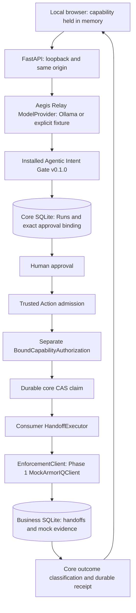

# Aegis Relay — Phase 1 architecture

A permissioned AI agent for secure incident handoffs. **Trust the intent. Govern the action.**
This is Phase 1 Local E2E for Flow State — AI Agent & MCP Hackathon, organized by
ArmorIQ. Policy enforcement is simulated; real ArmorIQ SDK integration belongs to Phase 2.

The consumer imports only `agentic_intent_gate.runtime` for runtime integration.
`ToolCapability`, `ToolBinding`, `ExecutableRegistry`, `CapabilityVerifier`,
`BoundCapabilityAuthorization`, `open_runtime`, `ExecutionSpec`, `ToolOutcome`,
`Outcome` and `provision_capability` are the installed public API. Providers implement
the public `ModelProvider.generate_plan` protocol. Tests additionally exercise public
Run/Action commands and repositories supplied by `Runtime`.

`runtime.http_app()` supplies Plan, Run, approval, admission, authorization, execution
and Action retrieval endpoints. It is mounted inside an outer FastAPI application with
the custom consumer UI and business read/policy endpoints. The mount and `open_runtime`
context are created in FastAPI lifespan and removed/closed on shutdown. The core owner
lock remains held for the entire serving lifetime. No core services, repositories,
schema files, prompt, UI admission behavior or Action state machine are replaced.

The consumer adds capability checks to planning, Run/approval and business endpoints;
the unchanged core Action routes retain their own capability and operation checks.
Host/origin validation, no CORS, no cookie authority, no query-string authority,
no-store responses and a self-only CSP support the local single-operator assumptions.
This does not provide production users, TLS or protection from a hostile local host.

## Identity and data

`safeops init` exclusively provisions an ACL-private directory on Windows (0700 on
POSIX) and uses the core capability provisioner for its private token file. Stable
`identity.json` records manifest version, subject `safeops-local-operator`, policy
revision `safeops-policy-v1`, exact binding including randomly generated execution
scope, and independent store UUID. Identity is read and checked at every startup.
No normal startup initializes missing stores, migrates schema or changes identity.

The core gate DB owns Runs, Run audit events, approval decisions, approval Plan
bindings, Actions, Action admission/command receipts, authorizations, execution
attempts and Action audit events. The consumer never writes these tables directly.

The separate business DB owns:

| Table | Purpose |
| --- | --- |
| `identity` | Singleton store UUID and exact binding identity |
| `handoffs` | Unique effect key, payload digest, store/binding identities, bounded business fields, unique receipt UUID and UTC timestamp |
| `policy_evidence` | Local mock decisions, operation, optional effect key, reason and timestamp; explicitly `MOCK` |

An execution specification is checked against the trusted binding and the same bounded
argument rules before any policy/business effect. The mock compares the compiled
payload digest, tool identity and scope. The business transaction uses `BEGIN IMMEDIATE`,
SQLite `synchronous=FULL`, an effect-key primary key and a receipt uniqueness constraint.
Exact replay returns the existing receipt; a changed payload is rejected without
overwriting the record. Durability means acknowledged local SQLite commits under its
normal filesystem assumptions, not proof against hardware/storage failure.

## Failure semantics

Provider text never registers tools or grants authority. The closed Plan and flat
argument schema reject arbitrary targets, additional fields, tool/version changes,
empty/oversized/wrong-type arguments and extra steps. The supported HTTP budget limits
planning to about 28 seconds. Timeout becomes `MODEL_TIMEOUT`; invalid text fails core
validation. Provider-specific safe error codes are also exposed in status. Because the
public runtime module does not export a typed model error constructor, transport and
malformed HTTP-response exceptions become the core's `INTERNAL_ERROR` alongside the
consumer's specific `MODEL_UNAVAILABLE`/`MODEL_RESPONSE_ERROR`. No private imports or
exception monkeypatching are used.

After core authorization and claiming, local policy denial/mismatch creates no handoff.
The core's supported proven no-effect vocabulary is limited to `INPUT_REJECTED`,
`PAYLOAD_CONFLICT`, `STORE_IDENTITY_MISMATCH`; the adapter maps policy denial to
`INPUT_REJECTED`/`Failed` and retains the specific mock policy result in business audit
evidence. Service-unavailable, timeout, invocation ambiguity and post-commit acknowledgement
loss are conservative `Unknown` outcomes. A committed record can coexist with an
Unknown Action without a confirmed success receipt. Aegis Relay never retries or reconciles
it automatically. Exact core command replay only reads its durable result.

## ArmorIQ handoff boundary

`EnforcementClient.check` is a **consumer-owned interface**, not an SDK method claim.
Its explicit results distinguish Allowed, PolicyDenied, IntentParameterMismatch,
ServiceUnavailable, Timeout and AmbiguousInvocationOutcome. The offline fixture allows
only the trusted handoff tool/scope/target and denies `purge_incident_history`.
The policy lab checks a policy and writes local evidence; it creates no Action and has
no business invocation. Core rejection of an unknown tool occurs earlier in Plan validation.

Official [Python SDK docs](https://docs.armoriq.ai/platform/sdk-cli/python-sdk) describe
`capture_plan`, `get_intent_token` and `invoke`, which can route through an MCP proxy.
Phase 2 must decide whether supported enforce-only checks or proxy-owned invocation
fit this boundary. Merely calling remote `invoke` and then also persisting locally risks
two separate effects. Review this ownership, parameter binding, policy holds, timeouts,
token validity and transport idempotency before implementation. No exactly-once remote
guarantee is assumed. A minimal core extension would need a separate review if necessary.
