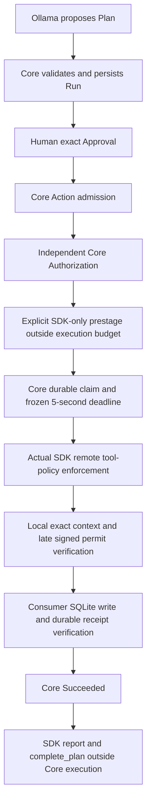

# Aegis Relay Phase 2.4 — application qualification

Measured 12 October 2026 NZDT / 11 October UTC. **PHASE24_APPLICATION_E2E=PASS**:
the existing FastAPI application and actual Chrome UI performed one expressly
approved fresh synthetic SDK-only handoff. **READY_TO_SUBMIT=NO**: video, submission
destination/exact deadline and new independent platform audit readback remain open.
No commit, push, deployment, submission, cloud policy/registration change or Core edit.

## A. Changes

`configuration.py`, `main.py`, `runtime_composition.py` add explicit `sdk-only` and
`proxy` selection; legacy `real` remains the proxy alias and MOCK stays the default.
`sdk_application.py` owns bounded per-Action ephemeral sessions and post-Core audit
handling. It calls the qualified `SDKOnlyHandoffExecutor`, not a second runtime.
`sdk_only.py` adds resource cleanup and closed UUID/lifecycle response evidence;
missing SDK response booleans are represented as unknown, not invented failure.

The existing consumer routes/UI add an explicit prepare button, backend stage/audit
status, the actual enforcement decision/policy/request ID restored from closed
consumer audit evidence, expiry controls, original intent restoration and historical canary
references. Capability contents remain memory-only. Test output can be routed to a
fresh ignored directory, preserving earlier evidence. Added application tests,
three Chrome scenarios and `scripts/sdk_only_browser_check.py` exercise this same app.
README, this report, Phase 2 summary, submission draft and demo script are updated.

## B. Architecture and safety ownership



Frozen Agentic Intent Gate **0.1.0**, commit
`fd742b783058a53400c465b4ab59c6e80715895a`. Installed direct URL and freshly read
annotated release tag's peeled SHA match; `pyproject.toml` and `uv.lock` pins remain
unchanged. Installed public signatures and the Core consumer example were inspected.
All validation, exact approval binding, authorization, CAS, durable claims, outcome
and idempotency decisions use its published API and unchanged HTTP execution route.

Preparation requires the exact Authorized Action and version. Its immutable envelope
binds reviewed Run/Plan, approval, authorization, trusted binding, scope/store, Action,
effect identity and exact arguments. Tokens stay server memory. Missing/expired stages
refuse execution before claiming; explicit preparation after expiry/restart is allowed
only while still Authorized and never executed. A failed/in-flight stage is not
automatically refreshed. Executing or terminal Actions cannot be prepared.

Remote Allow is **tool-level policy permission**. It proves neither remote argument
integrity nor remote permit verification. The actual outbound SDK request and raw
HTTP 200 Allow/policy ID/name are checked, then the exact local context is revalidated.
The existing Ed25519 permit is issued late and its signature/arguments/Action/attempt/
scope/store/expiry are verified. The worker thread only checks remote policy; it
cannot write after timeout. The selected SDK-only executor is the sole local writer;
the outer HandoffExecutor returns its outcome without falling through to MOCK persist.

Proxy retains its separate forwarded MCP writer. No public MCP or custom domain is
needed for SDK-only. Reporting follows terminal Core success, is attempted once,
and can fail independently without changing Succeeded or repeating the business effect.

## C. Checks and exact counts

Python 3.13.9; installed SDK 0.6.10. Existing isolated environment used without
dependency upgrades or reinstallation. `uv sync --locked` was unnecessary and NOT RUN.

```powershell
$phase24Python = '.artifacts/phase2-20261011/venv/Scripts/python.exe'
$env:SAFEOPS_TEST_ARTIFACTS = 'D:/workshop/oct/aig-flow-state/.artifacts/phase24-20261012/final-policy-full-artifacts'
& $phase24Python -m pytest -q --basetemp=.artifacts/phase24-20261012/final-policy-full-state --junitxml=.artifacts/phase24-20261012/final-policy-full.xml -o cache_dir=.artifacts/phase24-20261012/final-policy-full-cache --tb=short
& '.artifacts/phase2-20261011/venv/Scripts/ruff.exe' check src tests scripts
& '.artifacts/phase2-20261011/venv/Scripts/ruff.exe' format --check src tests scripts
uv lock --check
node --check src/safeops/api/static/app.js
git diff --check
```

Stable focused qualification: **50 passed in 131.85 s**, including all 24 original
Phase 2.3 SDK cases and three new actual Chrome SDK-only scenarios. Initial complete
suite: **178 passed in 395.42 s**, including **14 actual Chrome tests**. The final
full rerun after intent/response-metadata corrections: **179 passed in 373.59 s**,
including **14 actual Chrome tests**, recorded in `final-full.xml`. The subsequent
policy display addition found missing diagnostics on three intermediate audit events
(3 failed / 24 passed in 105.10 s); corrected reading now passes **27/27 focused
cases in 102.06 s**, including three Chrome cases. Final comprehensive regression:
**179 passed, 14 Chrome tests, 369.90 s**, recorded in `final-policy-full.xml`. Eight
SDK/Starlette deprecation warnings are retained, not patched in dependencies.

Safety coverage includes unapproved/Pending execution, stale/exact approval, missing
or wrong authority/binding/target/scope, changed arguments/tool/version/revision,
cross-Action token substitution, missing/expired/restart-lost stages, forged/expired
permits despite Allow, block/hold/timeout/error/wrong-policy responses, frozen Core
timeout with no late write, concurrent Core claims, stable duplicate receipts/conflicts,
post-commit Unknown without redispatch, successful execution with audit failure,
capability/origin checks, closed request bodies and credential redaction. The SDK is
real installed code over explicit OFFLINE MockTransport in regression tests; those
policy responses are not cloud evidence.

## D. Real browser workflow and durable verification

The operator explicitly approved the exact synthetic Plan below after the 178-case
suite passed. Real Chrome clicked the application UI; no qualification harness
called gateway approval/admission/authorization/execution directly.

```json
{"incident_id":"INC-24001","summary":"Synthetic Phase 2.4 browser qualification","handoff_note":"Synthetic test only; no operational incident or external recipient."}
```

| Item | New Phase 2.4 evidence |
| --- | --- |
| Run | `eb30069a-3aba-4a53-b1c9-d9cd16be2388`, Approved v5 |
| Exact approval | `3f44a869-cdc7-4580-918b-4aa83bf9b86b`, BOUND_V1 |
| Independent authorization | `c3513f89-d42d-4306-92db-9825d9f9cf0a` |
| Action | `4a6e877c-d60a-4651-b0eb-76058a6bf30e`, Succeeded v4 |
| Effect | `2373a586-591f-4bd0-bb23-a85c00e65cc1` |
| Matching receipt | `6b42e4b8-4e10-43d8-a832-a5d98d68d1b0` |
| Executed ArmorIQ Plan | `0c18970d-8534-44b8-944a-b9dfa9005072` |
| Remote Allow request | `62022016-ccff-4de7-8174-6e59affd812d` |
| New remote audit ID | `654b662f-11af-4fae-b412-aa3bf4225af9` |
| Audit HTTP request ID | `45e55e61-af65-4b18-b5de-24bf257bd09a` (distinct from audit ID) |
| Payload digest | `f9a3ff7c7682af0b8c8d8fec9ddbab3b6be91ce96e2473c76c3090e64a34e7c3` |

Click trace UTC: generate at 21:25:05; approve 21:30:53.190; admit 21:30:53.550;
try unauthorized 21:30:53.683 (denied, zero effects); independently authorize
21:30:53.901; final explicit preparation 21:32:25.062; **one execution click**
21:32:30.227; exact idempotency replay 21:32:33.775. Refresh and real-process restart
restore the same Action/receipt/record and unchanged audit evidence using GETs only.

There were helper-only interruptions, kept as evidence: a five-second planning wait
ended while the valid Run finished; a closed stdin ended the next review before
approval; and a five-second preparation wait ended after successful preparation.
The same reviewed Run and same Authorized Action were restored. The first token
was lost/expired without any attempt or effect; explicit restart preparation created
the executed Plan above. Its abandoned Plan `36ef5287-9024-4bfe-9d00-f5f806ba5010`
was not success-reported. These were not business retries. The final helper uses
explicit waits and a closed approval file matched to the Run/exact arguments.

Closed-process, **read-only SQLite** verification independently confirms one Action,
one authorization, **one attempt**, one business row, exact Plan/approval/spec hashes,
matching effect/digest/receipt and events at versions 1,2,3,4. Evidence:
`.artifacts/phase24-20261012/new-disk-verification.json`. No previous Unknown was
opened for execution or reconciled; historical INC-23001 was never repeated.

## E. Remote policy and audit distinctions

Real HTTPS `/iap/sdk/enforce`: HTTP 200, explicit Allow, expected policy
`c4b4d803-aefd-4c74-bc0c-dbb4564d399c`, name
`cli-aegis-relay-aegis-relay-mcp`. Preparation read the existing target association
to MCP `0b4133a0-9acd-451b-84a2-a795d9c593c5` before token issuance. No registration
or policy was changed. The policy governs the registered handoff tool even though
the optional proxy's retired endpoint/discovery remain unqualified.

The actual `report` request is guarded against changes to Plan/step/tool/MCP/input/
output/user attribution and includes the new Core Action/effect/digest/receipt.
It receives HTTP 200 plus the new audit ID and matching Plan ID. `complete_plan`
returns HTTP 200, `success=true` and matching Plan ID. **POST acknowledgement and
local/wire correlation PASS; independent new dashboard persistence UNVERIFIED.**
The first observer recorded `success=false` for the audit response because it used
`raw.get('success') is True`; that field conflated absent and false. It is not proof
of a server rejection. The final observer preserves absence as null; completion's
explicit true was captured independently. Original wire evidence is not rewritten.

Separate fresh organization observability GET with SDK credentials returns **401**;
connected dashboard browser inventory is empty. This is an auth/access limitation,
not proof that the new audit row is absent. No browser credentials/JWT were extracted,
and no login/key creation was attempted. New platform Action/receipt row readback
remains BLOCKED; search the new audit ID in the existing organization's API Logs.

Real canary denial is **reused historical Phase 2.2 evidence**, request
`a1d37130-5f82-4e91-a752-6f58c9172f59`, same policy, explicit Block with
`tool_not_in_allowlist`. No new Phase 2.4 canary request or destructive effect.

All six operator originals were visually reviewed and verified against the actual
handoff manifest: **6/6 SHA-256 and byte counts match**; reviewed copies are identical.
Historical visible Audit rows PASS. Historical API detail request
`b766e35d-9810-4095-9986-66989d1e907e` matches Phase 2.3 INC-23001, Action
`44018e15-1500-42e2-816e-81470ffc13c3` and receipt
`36f0db1a-e81e-4e28-9dae-74894aa1d1e4`. Audit table internal row UUID remains
UNVERIFIED. Event activity and aggregate counts are not per-effect evidence.
Those historical screenshots do not establish new Phase 2.4 dashboard correlation.

## F. Measured latency

| Stage | Actual milliseconds | Budget |
| --- | ---: | --- |
| Preparation UI, inventory/client/token included | 4,960.379 | Outside Core execution |
| Adapter token prestage | 2,294.566 | Outside Core execution |
| Remote enforcement | 928.855 | Inside Core execution |
| Durable SQLite business persistence | 8.035 | Inside Core execution |
| Executor, including late permit/validation/receipt | 1,205.339 | Inside Core execution |
| Persisted claim → Core terminal | **1,259.307** | **Below frozen 5,000 ms** |
| Audit POST wire duration | 818.009 | After Core Succeeded |
| Completion wire duration | 630.579 | After Core Succeeded |
| Execute UI, including post-Core lifecycle | 3,433.829 | Not the Core-only duration |

Remaining immediately before business write: Core 3,805.865 ms; permit 3,555.890 ms.
No expiry extension or increased Core limit. One new measured success plus historical
qualification are a small sample, not a percentile, availability or production SLA.

## G. Screenshots and private evidence

New unretouched browser evidence, distinct from the six historical platform images:

| Screenshot beneath `.artifacts/phase24-20261012/` | What it shows |
| --- | --- |
| `live-browser-2/01-new-plan-awaiting-approval.png` | Actual real Ollama Plan before approval |
| `live-browser-qualified/02-authorized-no-effect.png` | New Authorized Action, zero effects |
| `live-browser-final/03-prestaged-no-effect.png` | Final READY stage, same Authorized Action, zero effects |
| `live-browser-final/04-new-success-receipt-audit.png` | Succeeded, one handoff/receipt, new audit acknowledgement, exact replay |
| `live-browser-final/05-refresh-restored.png` | Refreshed persisted Action/receipt |
| `live-browser-final/06-process-restart-restored.png` | Actual subprocess restart retains success/receipt/audit |
| `final-read-only-ui-restored.png` | Final UI restores INC-24001 intent; terminal execution/preparation disabled |
| `policy-display-read-only-ui-restored.png` | Same persisted Allow, policy/request ID and receipt displayed without another SDK call |

Screenshots and manifests stay ignored/private, with no capabilities, raw tokens or
signing keys displayed. Earlier captures show stale status-card text until reload;
the final UI refreshes backend status after preparation and restores the saved intent.
The generic filename `live-browser-final/01-new-plan-awaiting-approval.png` was taken
after restoring an already Approved Run; it is not used as pre-approval proof.
Original captures/result JSON remain unchanged; final display verification uses
read-only restoration and no further business execution. That final real Chrome
check PASS: zero execution clicks and model calls, unchanged Action/business/audit
responses, one record, matching receipt, cleared capability file input.
The subsequent policy display check also PASS: it restores the exact original
Allow request `62022016-ccff-4de7-8174-6e59affd812d` from persisted consumer evidence.
The final UI differentiates OFFLINE policy responses from real remote responses.
`screenshot-evidence-index.json` records hashes/sizes for **50 new test/intermediate/
application captures**, with the **eight selected actual live UI captures** above
identified separately, and the six unchanged historical operator originals.

Key evidence: `manifest-verification.json`, `stable-focused.xml`, `full.xml`,
`final-full.xml`, `final-policy-full.xml`, `policy-display-fixed.xml`,
`screenshot-evidence-index.json`, `live-browser-2/review.json`, `live-browser-qualified/result.json`,
`live-browser-final/result.json`, `new-disk-verification.json`,
`new-audit-readback.json`, `preservation-result.json`, and delivery/secret-scan evidence.

## H. Demo/submission preparation and human work

Updated [demo script](demo-script.md) and [copy-ready draft](submission.md) distinguish
new execution, historical denial/screenshots and remaining audit limitations. SDK
integration without an MCP server is accepted by the [official FAQ](https://armoriq.ai/hackathons/flow-state).
Rechecked 12 October: the official page gives **17 October 2026, UTC**, says exact
deadline hours publish with official rules, and provides no retrieved formal submission
form or precise hour. [Luma](https://luma.com/tttqkw24) is event registration with
host approval, not proof of project submission. Official portal/hour remain UNVERIFIED;
confirm them in the organizer's existing community without assuming Auckland midnight.

Human work: independently view the new audit ID/Action/receipt in the existing
authenticated platform, record/upload a short demo, confirm registration/rules/form/
deadline, then separately authorize source publication and final submission.
No video was recorded, no public endpoint created and no submission receipt exists.

## I. Preservation and secrets

The 8,477-entry initial protected-path inventory includes two historical
`verification/tests` **directory junctions targeting the current tests tree**.
Sixteen changes are expected aliases: eight references to four edited live harness
sources and eight generated bytecode references. They are not historical evidence
copies. The other **8,461 protected paths** retain their hashes/locked-file metadata;
no unexpected changes, including historical screenshots/manifests and all old runtime
states. All **73 installed Core/SDK Python files** remain byte-identical. Phase 2.3
reports/harness/results remain unchanged; its original qualified adapter/tests were
also retained privately before application integration. Old Unknown's 22 files and
INC-23001 state are untouched. Package pin and Git HEAD remain unchanged.

Public source/documentation and deliverable scans compare actual private key/capability/
credential bytes in memory and detect key/JWT patterns. Ignored private state is not
a public deliverable. Source-only packaging excludes `.runtime`, `.artifacts`, `.git`,
credentials, databases, screenshots and caches; the old mixed workspace ZIP is neither
used nor changed. Final scan/package verification results are in delivery evidence.
The source-only review ZIP is
`.artifacts/phase24-20261012/aegis-relay-phase24-source-review.zip`;
it contains 68 source/documentation/configuration files, with no private evidence.
Final secret scan PASS: **68 source files + 13 sanitized evidence files**, comparing
**5,572 private-value variants** from credentials and **3,053 private key/capability
files** in memory, with zero findings. Ruff lint/format, JS syntax, lock consistency
and Git diff checks all exit 0. Git's configured line-ending warnings and eight
dependency deprecation warnings are retained. ZIP CRC/member-content verification
and its SHA-256 are recorded in `delivery-verification.json`; nothing is published.

## J. Release decision and gates

**Application execution qualified; final submission readiness remains NO.** New
remote audit readback is BLOCKED by JWT/browser access. Historical platform evidence
is accepted within its documented limits. Proxy forwarding remains historically
unqualified; MOCK and legacy proxy offline compatibility pass. No new business
write is needed to resolve audit/video/submission blockers.

```text
BRAND_AEGIS_RELAY=PASS
PINNED_CORE_UNCHANGED=PASS
PHASE23_HARNESS_BASELINE_PRESERVED=PASS
MOCK_MODE_E2E=PASS
LEGACY_PROXY_MODE_COMPATIBILITY=PASS (offline; historical remote proxy remains unqualified)
SDK_ONLY_MODE_IN_REAL_FASTAPI=PASS
POST_APPROVAL_PRESTAGING=PASS
PRESTAGING_EXPIRY_AND_RESTART=PASS
CORE_EXACT_APPROVAL=PASS
CORE_INDEPENDENT_AUTHORIZATION=PASS
REMOTE_ARMORIQ_SDK_ALLOW=PASS (new Phase 2.4)
REMOTE_ARMORIQ_CANARY_DENY=PASS (historical Phase 2.2; no new probe)
LOCAL_ARGUMENT_AND_PERMIT_BINDING=PASS
ONE_DURABLE_BUSINESS_EFFECT=PASS
MATCHING_RECEIPT=PASS
CORE_ACTION_SUCCEEDED=PASS
NO_DOUBLE_WRITE=PASS
NO_UNKNOWN_RETRY=PASS
REAL_BROWSER_CLICK_E2E=PASS
LIVE_LOCAL_OLLAMA=PASS
AUDIT_POST_ACKNOWLEDGED=PASS
PLATFORM_AUDIT_ROWS_VISIBLE=PASS (historical operator evidence)
PLATFORM_API_LOG_REQUEST_ID_MATCH=PASS (historical Phase 2.3)
PLATFORM_API_LOG_ACTION_RECEIPT_MATCH=PASS (historical Phase 2.3)
AUDIT_LOG_ROW_INTERNAL_UUID_MATCH=UNVERIFIED
PHASE24_NEW_AUDIT_CORRELATION=PARTIAL (wire/ACK PASS; new independent dashboard readback BLOCKED)
RUN_AND_RECEIPT_SURVIVE_REFRESH=PASS
FULL_CONSUMER_REGRESSION=PASS (179 tests, 369.90 s, 8 dependency warnings)
BROWSER_REGRESSION=PASS (14 Chrome tests)
SECRET_SCAN=PASS (source, sanitized evidence and source-only ZIP)
SUBMISSION_MATERIALS=PASS (draft/script; video/form/publication pending)
VIDEO_RECORDED=NO
PHASE24_APPLICATION_E2E=PASS
READY_TO_SUBMIT=NO
ACTUALLY_SUBMITTED=NO
```
