# Aegis Relay — submission draft

**Trust the intent. Govern the action.**

A permissioned AI incident handoff assistant that turns a reviewed intent into one
authorized, policy-checked handoff with a durable receipt.

## Problem

An agent can propose a sensible action without being entitled to execute it.
For incident operations, an unreviewed or changed handoff can become persistent
business data. Operators need to understand the proposed action, control whether
it executes, and verify what actually committed.

## Solution and walkthrough

Aegis Relay uses local Ollama to propose one bounded incident handoff. Its FastAPI
UI persists the Plan for review. Exact human Approval, durable Action admission
and independent execution Authorization are separate controls. Approval alone
cannot write. After authorization, the operator explicitly prepares an ArmorIQ
SDK-only Plan and token. Missing or expired preparation fails closed.

During Core execution, actual remote ArmorIQ policy must explicitly Allow the
registered handoff tool under the expected policy. The consumer revalidates the
exact approved arguments and Core context, issues and verifies a late Ed25519
dispatch permit, and commits one SQLite handoff. It checks the persisted effect
against its receipt before Core Succeeded. SDK audit reporting and Plan completion
follow Core's terminal result. Reporting failure cannot repeat the business write.

```mermaid
flowchart LR
    O[Local Ollama Plan] --> H[Exact human Approval]
    H --> A[Core admission and separate Authorization]
    A --> P[Explicit SDK-only preparation]
    P --> R[Core claim and remote ArmorIQ tool-policy Allow]
    R --> L[Local exact context and signed permit checks]
    L --> W[One SQLite effect and matching receipt]
    W --> S[Core Succeeded]
    S --> Q[SDK report and complete_plan]
```

## ArmorIQ integration and the boundary

The pinned Python SDK is 0.6.10. Its SDK-only lifecycle is
`start_session(mode="sdk") → start_plan → check → local execution → report → complete_plan`.
This mode requires an authorized ArmorIQ account and existing credentials; it is
not an account-free cloud demonstration. It does not need a public MCP server or
custom domain. MOCK and the separate legacy proxy route remain available.

Remote Allow is tool-level policy permission. Aegis Relay does **not** claim that
ArmorIQ verified the exact parameters or local signed permit. Those integrity
checks belong to the consumer. Historical real enforcement blocked the harmless
`purge_incident_history` canary; the canary has no destructive implementation.
The demo clearly identifies those earlier platform rows as historical.

## Evidence and reliability

The earlier, expressly approved Phase 2.4 real Chrome/Ollama workflow produced one
synthetic INC-24001 handoff, one persisted attempt and one matching receipt, with
Core Succeeded. Actual remote enforcement measured 928.855 ms; Core claim-to-terminal
measured 1,259.307 ms inside its unchanged five-second deadline. One sample is not
a performance SLA. Refresh and process restart preserved the same result.

The historical full consumer regression passed 179 tests, including 14 actual
Chrome tests, in 369.90 seconds. These are Phase 2.4 results, not newly repeated
Phase 2.5 results. The final delivery adds a current, mutation-blocked read-only
Chrome recording and separately reports its new local validation checks.

ArmorIQ audit POST and completion were acknowledged for the new Plan. New audit ID:
`654b662f-11af-4fae-b412-aa3bf4225af9`. Independent new platform readback remains
pending authenticated access. Historical Phase 2.3 API detail
`b766e35d-9810-4095-9986-66989d1e907e` is separately correlated and does not prove
the new Phase 2.4 row. The video preserves that distinction.

## Pre-existing dependency and competition work

[Agentic Intent Gate](https://github.com/miku-wwl/agentic-intent-gate) is a pre-existing,
separately maintained project dependency operated by the same maintainer. It is
reused through its public integration API at v0.1.0, pinned to
`fd742b783058a53400c465b4ab59c6e80715895a`. Core development is not represented as
work completed during this hackathon. Competition-specific work comprises the
incident product, trusted consumer tool/store, Ollama provider, FastAPI UI,
ArmorIQ adapters, local dispatch integrity and integration/demo qualification.

## Reproduction and limits

Use Python 3.13 and the checked-in lock file. See the README for exclusive fresh
state initialization. `--provider fixture --enforcement-mode mock` is explicit
offline planning and simulated policy; `--provider ollama --enforcement-mode mock`
uses a real local model with simulated sponsor policy. `--enforcement-mode sdk-only`
requires existing private account credentials and exact authorization of any fresh
synthetic live write. The saved completed Run must be viewed read-only.

One explicitly registered SIDE_EFFECT tool and one-step execution are supported.
This is a local, single-operator hackathon application, not a production multi-user
service or general workflow engine. Unknown outcomes are never blindly retried.
No guaranteed exactly-once remote side effect is claimed. Prior Unknown and
historical INC-23001/INC-24001 writes are preserved and never repeated for delivery.

Repository: [https://github.com/miku-wwl/aig-flow-state](https://github.com/miku-wwl/aig-flow-state)

Verified published Phase 2.4 revision: [0058242c4fda4b30065cd19225566d6e814bf074](https://github.com/miku-wwl/aig-flow-state/commit/0058242c4fda4b30065cd19225566d6e814bf074)

Demo video: **LOCAL MP4 PREPARED; PUBLIC URL PENDING APPROVAL AND HOSTING**.
No public video link or submission receipt is invented. The revision above identifies
the qualified Phase 2.4 application baseline; this documentation update records
Phase 2.5 delivery completion. Video and evidence assets remain local.

## Delivery/publication status

Phase 2.4 source publication was verified against local and remote main on 12 October
2026; it is no longer an uncommitted-only application. Historical qualification
reports describe what was true at their earlier execution time and remain unchanged.
Phase 2.5 evidence, narration, SRT and local MP4 are prepared under ignored
`.artifacts/final-submission/`. They are not publicly uploaded. The documentation
update records their local completion; public media publication still requires approval.

Actual public demo video URL: PENDING_PUBLICATION_APPROVAL.
Official submission URL/hour and individual registration approval: UNVERIFIED.
New independent ArmorIQ audit readback: BLOCKED pending authorized browser access.
READY_TO_SUBMIT=NO. ACTUALLY_SUBMITTED=NO.
